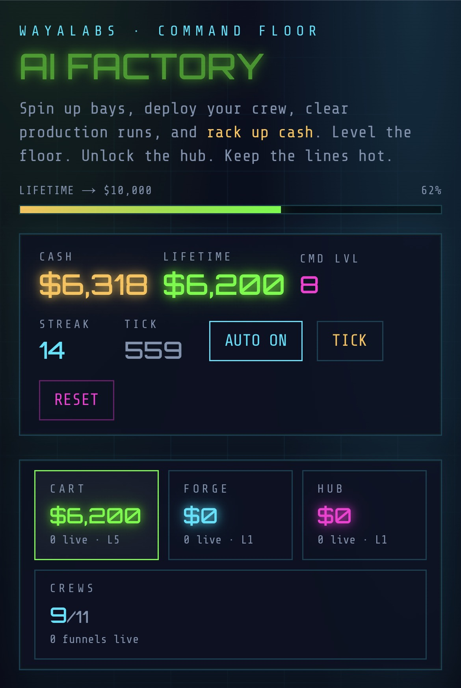
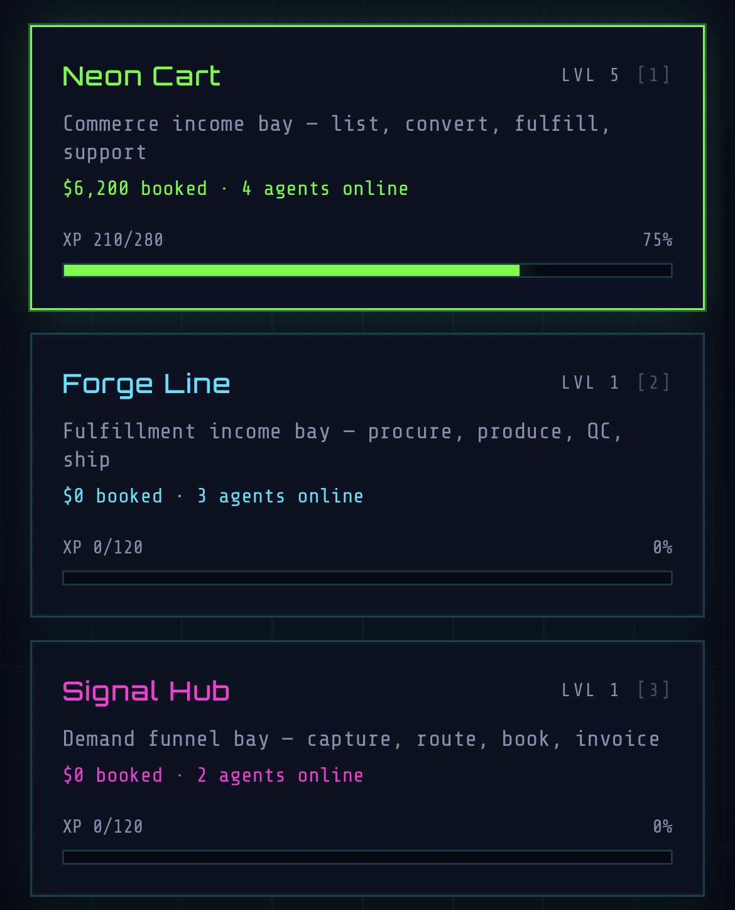
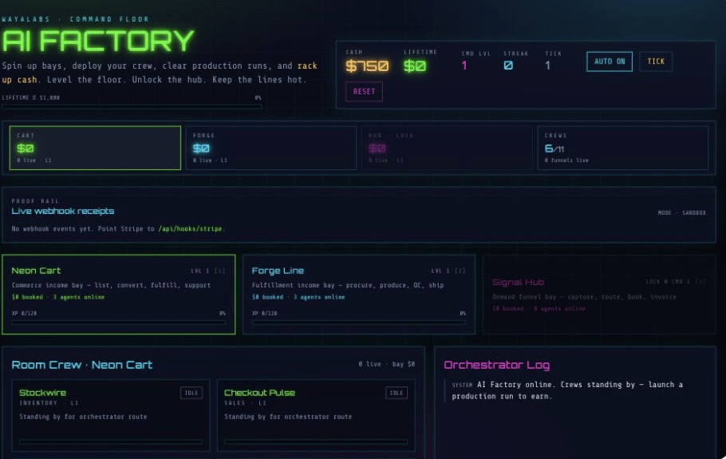
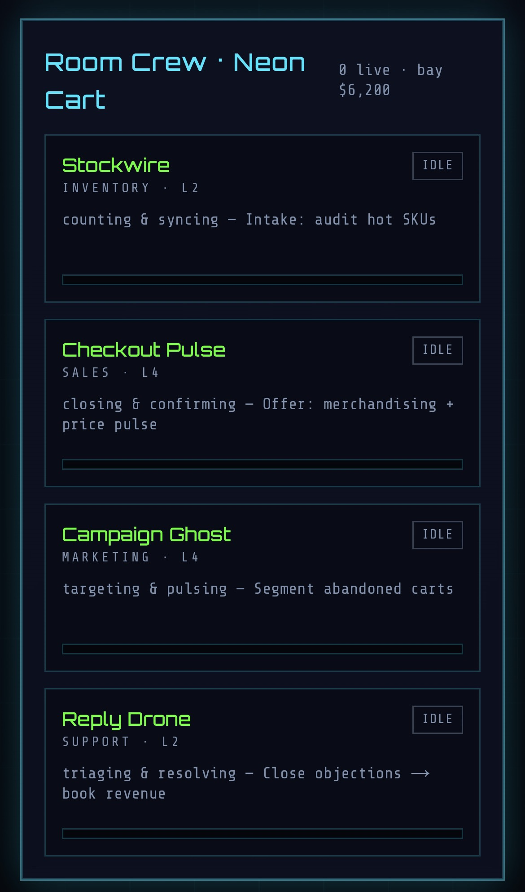
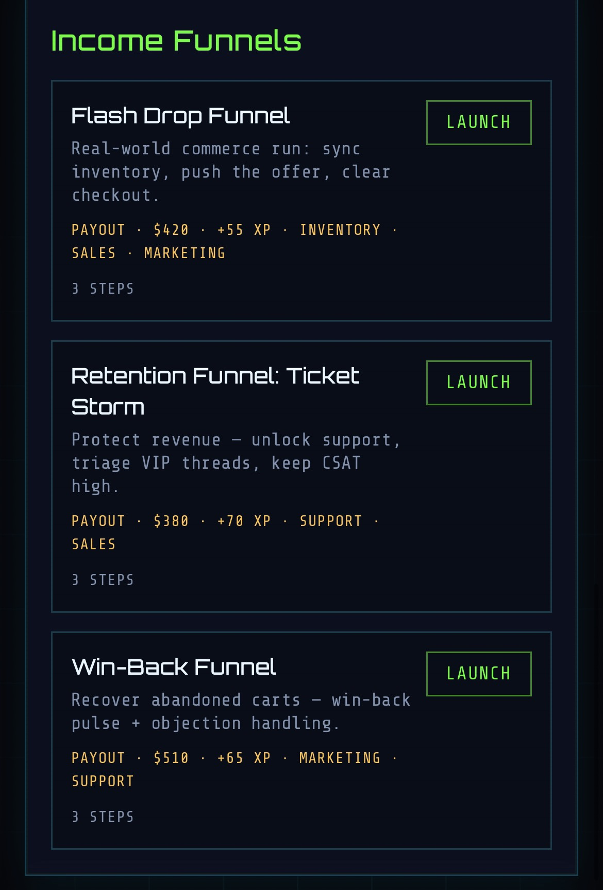
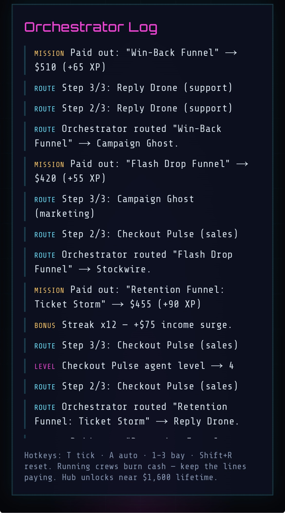
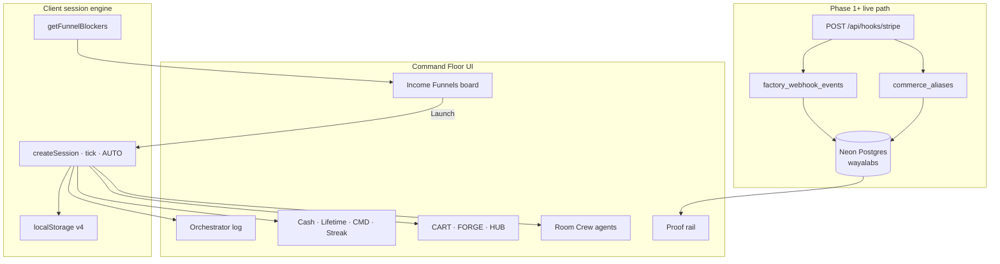

<p align="center">
  
</p>

<h1 align="center">AI Factory</h1>

<p align="center">
  <strong>Wayalabs · Command Floor</strong><br />
  Spin up bays, deploy your crew, clear production runs, and rack up cash.
</p>

<p align="center">
  <a href="https://ai-factory-pink.vercel.app"><strong>Live demo</strong></a>
  ·
  <a href="../../docs/internal/ai-factory-production.md">Production plan</a>
  ·
  <a href="openapi/factory-v0.yaml">OpenAPI</a>
</p>

<p align="center">
  
  
  
  
  
  
  
  
  
</p>

---

## North star

1. **Assemble agent teams** per bay (named roles, unlocks, levels)
2. **Run real-world income funnels** (intake → work → review → collect)
3. **Book income** — cash + lifetime revenue is the score; XP only powers the crew

Sandbox ticks simulate USD today. Phase 1+ wires Stripe webhooks into a **Proof rail**; live mode will book only from verified receipts.

---

## Snapshots

| Command floor | Income bays |
|---|---|
|  |  |

| Proof rail | Room crew |
|---|---|
|  |  |

| Income funnels | Orchestrator log |
|---|---|
|  |  |

---

## Architecture



| Layer | Role |
|---|---|
| **Floor** | Neon ops HUD — bays, crew, funnels, proof rail, terminal log |
| **Engine** | Per-tab `createSession`; deterministic progress; unlock gating |
| **Webhooks** | Stripe signature verify → alias link → persist (no booking yet) |
| **Neon** | CRM + Factory tables (`DATABASE_URL`, pooled) |

Full production roadmap: [`docs/internal/ai-factory-production.md`](../../docs/internal/ai-factory-production.md).

---

## Income bays

| Bay | Factory | Job | Unlock |
|---|---|---|---|
| **CART** | Neon Cart | Commerce — list, convert, fulfill, support | Start |
| **FORGE** | Forge Line | Fulfillment — procure, produce, QC, ship | Start |
| **HUB** | Signal Hub | Demand — capture, route, book, invoice | ~$1,600 lifetime / CMD 3 |

### Room crew (Neon Cart)

| Agent | Role | Example work |
|---|---|---|
| Stockwire | inventory | Audit hot SKUs |
| Checkout Pulse | sales | Merchandising + price pulse |
| Campaign Ghost | marketing | Abandoned-cart win-back |
| Reply Drone | support | VIP triage · objections (bay L2) |

Forge and Hub crews follow the same pattern (ops, quality, procurement, logistics, sales).

---

## Game loop

1. Launch an **Income Funnel** (e.g. Flash Drop · $420 · +55 XP)
2. Orchestrator **routes** each step to a room-crew agent
3. **Tick** advances work (`AUTO ON`; faster while funnels are live)
4. Clear funnel → **cash** + bay revenue + XP → unlock agents / command
5. **Streak** + parallel-bay bonuses stack payouts
6. Working agents burn **opex** — keep lines converting

Progress saves to `localStorage` (`wayalabs-ai-factory-v4`).

### Hotkeys

| Key | Action |
|---|---|
| `T` | Manual tick |
| `A` | Toggle AUTO |
| `1`–`3` | Select bay |
| `Shift+R` | Reset run |

---

## Stack

| Layer | Choice |
|---|---|
| Framework | Next.js 16 (App Router, Turbopack) |
| UI | React 19 · Tailwind CSS 4 · Orbitron / Share Tech Mono |
| Engine | TypeScript session orchestrator · Vitest |
| Persistence | `localStorage` (sandbox) · Neon Postgres (live proofs / CRM) |
| Webhooks | Stripe HMAC verify · commerce-key alias graph |
| Deploy | Vercel project `ai-factory` · `FACTORY_MODE=sandbox` |

```
prototypes/ai-factory/
├── openapi/factory-v0.yaml          # Control plane + hooks contract
├── docs/snapshots/                  # Floor screenshots
├── src/
│   ├── app/api/
│   │   ├── factory/                 # Legacy tick API + /proofs
│   │   └── hooks/stripe/            # Webhook ingress
│   ├── components/
│   │   ├── Dashboard.tsx            # Command floor
│   │   └── ProofRail.tsx
│   └── lib/
│       ├── engine/                  # Sandbox game loop
│       └── factory/                 # Live types, ingest, commerce keys
└── LICENSE                          # Proprietary
```

---

## Run

```bash
cd prototypes/ai-factory
npm install
npm run dev
```

```bash
npm test
npm run build
```

### Environment

| Variable | Required | Notes |
|---|---|---|
| `DATABASE_URL` | Phase 1 proofs | Neon pooled URL (already on Vercel) |
| `FACTORY_MODE` | optional | `sandbox` (default) · `shadow` · `live` |
| `STRIPE_WEBHOOK_SECRET` | for Stripe | Point endpoint at `/api/hooks/stripe` |

Sandbox play works with no env — each browser tab runs its own session.

---

## APIs

| Method | Path | Purpose |
|---|---|---|
| `GET` | `/api/factory/proofs` | Recent webhook receipts for the Proof rail |
| `POST` | `/api/hooks/stripe` | Verify + persist Stripe events (allowlisted types) |
| `GET/POST` | `/api/factory` | Optional tick/reset API (UI uses client session) |

Contracts: [`openapi/factory-v0.yaml`](./openapi/factory-v0.yaml) · types in [`src/lib/factory/`](./src/lib/factory/).

---

## Roadmap

| Phase | Status |
|---|---|
| **0** Contract freeze (types + OpenAPI) | Done |
| **1** Neon + Stripe persist + Proof rail | Done |
| **2** Shadow bots (draft-only + approvals) | Next |
| **3** First live CART Flash Drop (book on payment proof) | Planned |
| **4** FORGE / HUB live rails | Planned |
| **5** Multi-tenant productize | Planned |

---

## License

**Proprietary — All Rights Reserved.** See [`LICENSE`](./LICENSE).

© 2026 [Wayalabs](https://wayalabs.com). Not open source. Contact `admin@wayalabs.com` for licensing.

This package lives under `prototypes/ai-factory` until promoted to a standalone `0xwaya/ai-factory` repository. It is **not** wired into the main wayalabs.com Next app.
